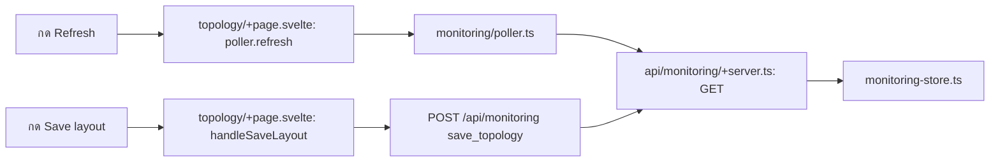

# csnis-source — กดแล้วโค้ดไปไหน

| ผู้ใช้ทำอะไร | ตามไฟล์และฟังก์ชัน | ผลลัพธ์ |
| --- | --- | --- |
| เปิดแผนผังหรือกด Refresh | [topology/+page.svelte](src/routes/topology/+page.svelte) `initPoller()`/`poller.refresh()` → [poller.ts](src/lib/monitoring/poller.ts) และ [api.ts](src/lib/monitoring/api.ts) → `GET` ใน [api/monitoring/+server.ts](src/routes/api/monitoring/+server.ts) | โหลด snapshot เพื่ออัปเดต node/link และสถานะ |
| ลาก node/เพิ่มหรือลบอุปกรณ์และ link | handler `handleMoveDevice`, `handleAddCustomDevice`, `handleDeleteDevice`, `handleConnectLink`, `handleDeleteLink` ใน [topology/+page.svelte](src/routes/topology/+page.svelte) | เปลี่ยน snapshot บนหน้า; ยังต้องกด Save layout เพื่อส่งไป server |
| กด Save layout | `handleSaveLayout()` → `saveToServer()` ใน [topology/+page.svelte](src/routes/topology/+page.svelte) → `POST /api/monitoring` action `save_topology` ใน [api/monitoring/+server.ts](src/routes/api/monitoring/+server.ts) → [monitoring-store.ts](src/lib/server/monitoring-store.ts) | บันทึก topology แล้ว refresh snapshot |
| กด Reset layout | `handleResetLayout()` → `POST /api/monitoring` action `reset_topology` | ล้าง layout ที่บันทึกและโหลด snapshot อีกครั้ง |

อ่าน [คู่มือระบบ](../Docs/HandOn/csnis-portal.md) สำหรับ topology และสิทธิ์แก้ไข
